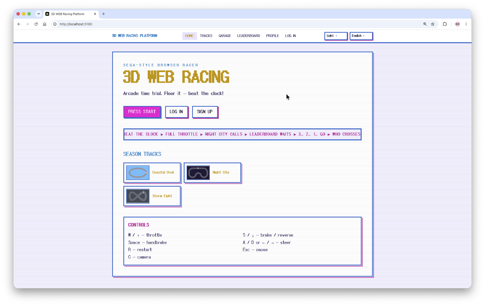
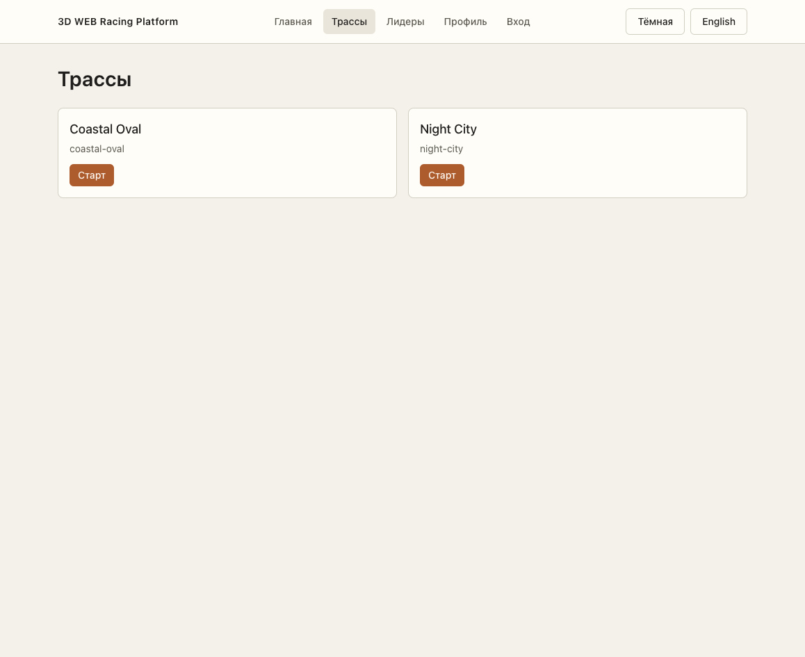
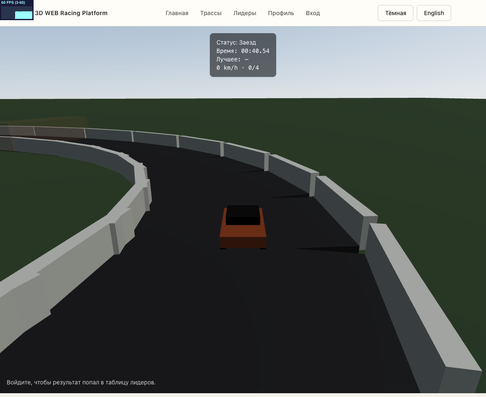
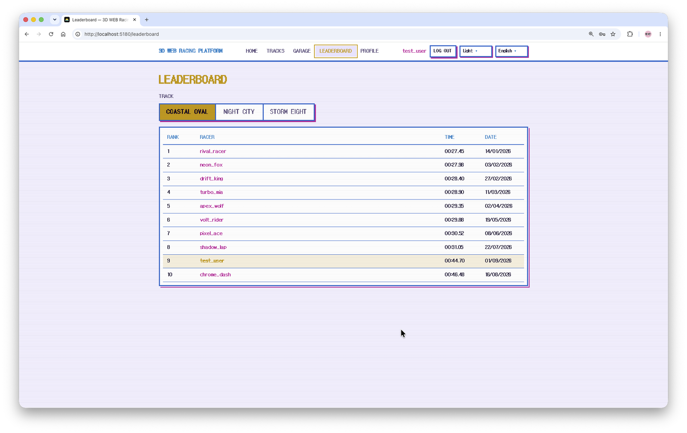
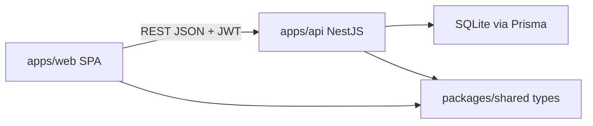
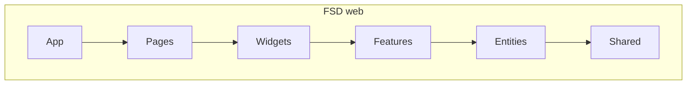
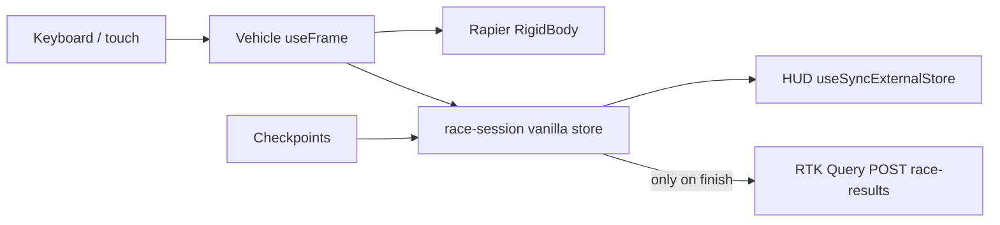

# 3D WEB Racing Platform

**English** | [Русский](README.ru.md)

Browser **time-trial** 3D racer: beat the clock, chase the leaderboard. React 19 + React Three Fiber + Rapier (WASM) physics on the front, NestJS 11 + Prisma 7 on the back. pnpm monorepo, Feature-Sliced Design, steady **~60 fps** in the browser.

[](https://github.com/ramach05/3D-WEB-Racing-Platform/actions/workflows/ci.yml)
[](LICENSE)
[](.nvmrc)
[](package.json)
[](tsconfig.base.json)

<!-- VIDEO SLOT (main hero video). After recording, replace the note below with:
        — recording spec: docs/development.md -->

> 🎥 **Gameplay video coming soon** — what it will cover and how to record it: [docs/development.md](docs/development.md#recording-gameplay-video).

| **Home**                              | **Tracks**                               |
| ------------------------------------- | ---------------------------------------- |
|         |          |
| **Race** — chase camera, HUD, minimap | **Leaderboard** — per-track, server-side |
|         |     |

## Engineering highlights

- **Race simulation does not live in Redux.** A vanilla store + `useSyncExternalStore` feeds the HUD (~80 ms throttled); time/speed are written straight to the DOM via rAF because React re-renders inside the physics loop measurably hitched Chrome. Redux/RTK Query is used only for auth/API and the one POST at the finish line. → [Performance](#performance--perf-hud)
- **Auth as a lifecycle, not an endpoint.** 15-min access JWT held in memory only, opaque refresh token in a path-scoped httpOnly cookie, SHA-256 at rest, rotation with lineage — and replaying a rotated token revokes **all** of the user's sessions. → [Auth & security](#auth--security)
- **558 unit/integration tests + 5 Playwright user flows.** CI gates `lint → typecheck → migrate → test → build`; a pre-commit hook repeats lint/prettier/typecheck locally. → [Testing](#testing)
- **FSD boundaries are enforced, not documented.** ESLint forbids cross-slice deep imports, `any`/`unknown`, relative parent imports and default exports.
- **In-game performance HUD** — FPS, main-thread busy %, JS heap: what a browser can honestly measure about its own load. → [Perf HUD](#performance--perf-hud)
- **Upstream patched** via pnpm `patchedDependencies`: a custom three-stdlib GLTF loader decodes texture bufferViews straight into `ImageBitmap` instead of blob URLs (faster, leak-free preload).

## Features

**Three tracks, each with its own weather, palette and music**

| Track        | Setting      | Character                                                                                                  |
| ------------ | ------------ | ---------------------------------------------------------------------------------------------------------- |
| Coastal Oval | Sunny day    | Fast oval, sun-aligned shadows, packed grandstands                                                         |
| Night City   | Night, clear | Moon + headlights + street lamps (LOD), neon bloom/vignette post-FX                                        |
| Storm Eight  | Rain         | Figure-eight with an elevated deck over the crossing, wet surface, rain and wheel spray, storm sky and BGM |

Every track: multi-lap with ordered checkpoints, dynamic obstacles (tire stacks, fuel barrels you can bounce off), oil slicks that cut grip, trackside props with real colliders (trees, billboards, lamps, tribunes).

**Garage — 5 GLB bodies fitted to real-world class scale** (4.14–5.71 m): hatchback, sedan, pickup, Juke, sport coupe. Paint shifts with the selected track; the garage preview is live — wheels steer and spin there, driven from measured axle positions.

**Physics (Rapier WASM)** — arcade, but consistent: fixed 1/60 step, steering independent of framerate, handbrake drift, per-surface feel (asphalt / kerb / offroad), dynamic obstacle damping, and the car stays glued on descending viaduct decks and crest slopes.

**Graphics** — procedural canvas textures (asphalt, kerbs, bark, crowd caps and flags), sun/moon shadows that follow the car, skid marks kept for the whole race, tire smoke, brake/reverse light modes, headlight beams bound to the car's _visual_ pose (no lag), F1-style start-light gantry.

**Audio — 100% synthesized in JavaScript.** Chip-rock BGM is generated at runtime by the Web Audio API (oscillators + filtered noise, ~150 BPM per-track themes, storm variations, victory theme on finish), with driving SFX and rain scene audio. Zero audio files shipped.

**Race UX** — three cameras (chase / bumper / TV) with FOV and shake, live minimap with a pose-projected vehicle marker, SEGA-style finish moment, pause menu, restart.

**Around the race** — per-track leaderboards (server-side, filterable by slug), guest mode with bests in `localStorage`, profile page with aggregate stats, per-track bests with rank and gap to the leader, and 6 achievements; i18n (EN/RU); light/dark theme; **mobile support**: touch controls (throttle / brake / steering / handbrake), compact HUD, safe-area insets and responsive layouts down to phone width.

## Controls

| Action                   | Keyboard       | Touch                   |
| ------------------------ | -------------- | ----------------------- |
| Throttle / brake+reverse | W / ↑ · S / ↓  | on-screen pedals        |
| Steer                    | A / D or ← / → | on-screen wheel buttons |
| Handbrake (drift)        | Space          | handbrake button        |
| Camera (chase/bumper/TV) | C              | —                       |
| Restart / pause          | R / Esc        | HUD buttons             |

## Architecture







```
apps/
  web/                 # Vite + React 19 SPA (game)
    src/
      app/             # entry, router, Redux store, i18n, theme CSS vars
      pages/           # home, race, garage, tracks, leaderboard, profile, login, register
      widgets/         # race-canvas, hud, minimap, countdown, pause menu, finish, leaderboard-table, vehicle-preview
      features/        # auth, race-session (store/input/physics), race-audio, race-perf,
                       # backend-status, locale/theme switchers, vehicle-select
      entities/        # track (layout, weather, obstacles), vehicle (GLB catalog),
                       # leaderboard, race-result (achievements)
      shared/          # api base, config (palette, i18n messages), ui kit, lib
    e2e/               # Playwright user flows
  api/                 # NestJS 11: auth, tracks, race-results, health; Prisma 7 + SQLite
packages/
  shared/              # transport types & constants — single source of truth for both apps
```

## Stack & why

| Choice                                                | Why                                                                                                                                                                     |
| ----------------------------------------------------- | ----------------------------------------------------------------------------------------------------------------------------------------------------------------------- |
| **Vite + React 19**, not Next.js                      | It's an SPA game. SSR/hydration with a WebGL canvas and Rapier WASM would only get in the way.                                                                          |
| **Race sim outside Redux**                            | Per-frame state in a global store means per-frame re-renders. Vanilla store + `useSyncExternalStore` keeps HUD updates out of the 3D frame.                             |
| **Rapier (`@react-three/rapier`)**                    | Deterministic WASM physics in the same component tree as R3F; fixed 1/60 step. Arcade goals, not an F1 simulator.                                                       |
| **three.js primitives + procedural textures**         | A ~60 fps budget rules out scanning marketplace GLTFs. Only the 5 garage bodies are GLB; everything else is geometry and canvas textures — small payload, full control. |
| **Redux Toolkit + RTK Query**                         | Kept where it fits: auth state, API caching, single mutations.                                                                                                          |
| **NestJS 11**                                         | Structured DI, guards, pipes and decorators; DTOs with `class-validator` give real input boundaries.                                                                    |
| **SQLite + Prisma 7** (better-sqlite3 driver adapter) | One file DB, no Docker — zero-friction clone & run; Prisma types shared with the frontend via `@racing/shared`.                                                         |
| **JWT access + rotating httpOnly refresh**            | See [Auth & security](#auth--security).                                                                                                                                 |
| **Web Audio synthesis**, not audio files              | Music/SFX are code: no binary assets, no licensing, per-track themes compose from note primitives, and the synth itself is a demo of the API.                           |
| **pnpm workspaces**, not Turborepo                    | Two apps and one shared package — an orchestrator would be ceremony. `patchedDependencies` upstream patch ships with the repo.                                          |

Packages: `@racing/web`, `@racing/api`, `@racing/shared`. Node **22.12+**, pnpm **10.15**.

## Auth & security

**Token model**

1. Login/register returns a **15-min access JWT** (HS256, issuer/audience pinned) that the client keeps **in memory only** — never in `localStorage`, so an XSS payload can't exfiltrate a persisted token; a reload transparently restores the session via the refresh cookie.
2. The **refresh token is an opaque random string in an httpOnly, `path=/auth` cookie** (`Secure`/`SameSite` configurable for production). The database stores only its **SHA-256 hash** — a DB leak yields nothing usable.
3. Every `/auth/refresh` **rotates** the session: the old row is revoked, `replacedById` records lineage. Replaying an already-rotated token (the theft signature) **revokes every session of the user**. Dead sessions are purged.

**Hardening**

- Passwords: bcrypt (cost 10); login against a nonexistent user compares against a dummy hash so response timing doesn't leak account existence.
- CSRF on cookie endpoints (`/auth/refresh`, `/auth/logout`): a custom `X-Requested-With` header is required when a refresh cookie is present — simple cross-origin form posts can't set it.
- Helmet, `@nestjs/throttler` rate limit on auth routes, global `ValidationPipe` with `whitelist` + `forbidNonWhitelisted`.
- Fail-fast boot on invalid environment (placeholder `JWT_SECRET`, missing `COOKIE_SECURE`/`CORS_ORIGIN` in production); Swagger disabled in production.
- Server-side anti-cheat floor: results faster than 8 s (physically impossible) are rejected; checkpoint order is validated on the client.

Honest scope: this is portfolio-grade, not payment-grade — symmetric HS256, no device fingerprinting or server-side lap simulation. The model is chosen to demonstrate correct token hygiene at demo scale.

## Performance & perf HUD

The budget is **~60 fps**, and the techniques are boring on purpose:

- Fixed 1/60 physics step; input and handling depend on `dt`, never on frame count.
- HUD notifications throttled to ~80 ms; time/speed written directly to the DOM in a rAF loop — React state updates inside `useFrame` were the root cause of a real Chrome hitch (see `1633782` in history).
- Renderer: `dpr` clamped to `[1, 1.5]`, 1024 shadow maps, sun/moon shadows that follow the car, street-lamp spot LOD with distance cutoff, per-scene light/shadow budgets (Night City), Bloom+Vignette only on the night track.
- Assets: everything procedural except 5 GLB bodies; a patched GLTF loader decodes texture bufferViews straight into `ImageBitmap`; bodies are preloaded before the race mounts; routes are lazy-loaded.
- App level: the SPA gates on API readiness, retries idempotent GETs with backoff, and recovers from WebGL context loss.

**Perf HUD (FPS / CPU / MEM).** A browser cannot read the system CPU, so the HUD measures what it honestly can: **FPS** — rendered frames/s; **CPU%** — the share of wall-clock time the **main thread** spends inside frame work (measured in the render loop, sampled every 250 ms) — i.e. "how busy this tab makes the machine"; **MEM** — `performance.memory.usedJSHeapSize` (JS heap), a Chromium-only API, hidden where unavailable. It pairs race stats (lap, split, best) with the cost of drawing them.

Measured: 60 fps during MVP verification of Coastal Oval runs (dev preview, Stats.js overlay). Verify it live — the HUD is in-game.

## Testing

```
558 tests (Vitest) — 522 web (unit + RTL/MSW integration, 98 files) · 28 API unit · 8 API e2e (supertest on a real Nest app, temp SQLite)
5 Playwright flows — auth/logout, guest profile, race flow, theme+locale, tracks+leaderboard
```

- MSW-backed integration tests instead of hand-rolled RTK Query mocks; unhandled requests fail the test.
- Playwright doesn't drive a car for 3 minutes: the race page exposes `window.__finishRaceForTest()` and the suite finishes through the real API path.
- Every logic change ships with its test in the same commit — physics, checkpoints, lap rules, obstacle placement, token rotation, anti-cheat floor.

## Quick start

```bash
pnpm install
cp apps/api/.env.example apps/api/.env && cp apps/web/.env.example apps/web/.env
pnpm --filter @racing/api prisma:generate   # generated client is gitignored
pnpm ready-steady-go                        # builds shared → prisma migrate+seed → runs web + api
```

| Web app                                        | API                                            | API docs                            | Health                                  |
| ---------------------------------------------- | ---------------------------------------------- | ----------------------------------- | --------------------------------------- |
| [http://localhost:5180](http://localhost:5180) | [http://localhost:3000](http://localhost:3000) | [/docs](http://localhost:3000/docs) | [/health](http://localhost:3000/health) |

Seed accounts: `test_user` / `1234` (plus rival `rival_racer` / `1234`). Requires Node **22.12+** and pnpm **10.15** — if anything refuses to start, the troubleshooting table and full command matrix are in [docs/development.md](docs/development.md).

## Trade-offs & limitations

- **Arcade physics**: yaw-only, walls slide the car instead of bouncing it, top speed ~108 km/h. A tire-model simulator is a different project.
- **Anti-cheat is minimal**: server-side floor is 8 s + checkpoint order validated in the browser. Server-authoritative lap simulation would be the next step.
- Guest bests live in `localStorage`; only authenticated finishes reach the leaderboard.
- Access JWT dies on reload by design (restored via refresh cookie).
- `performance.memory` is Chromium-only — MEM is hidden in Firefox/Safari.
- SQLite + no ORM-level pooling: right for a demo, wrong at scale; Prisma makes the swap cheap.

## Roadmap

- Gamepad support
- Per-wheel physics (independent suspension, per-tire grip)
- Third track / marketplace GLTF environment
- Ghost replays from recorded telemetry
- Hosted demo (web on a static host, API on a small VPS/Fly)

## License

[MIT](LICENSE)

## Author

Roman Kovalenko — [github.com/ramach05](https://github.com/ramach05)
