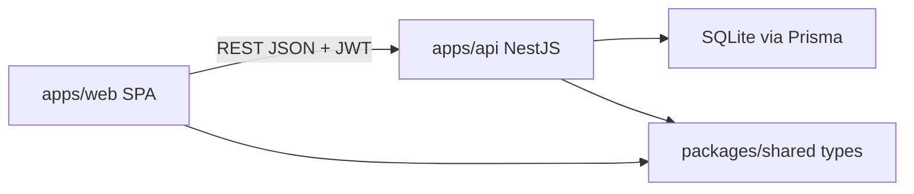
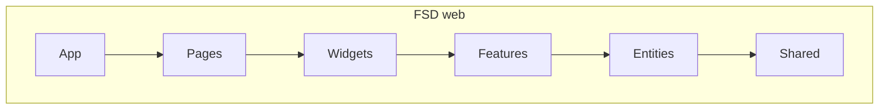
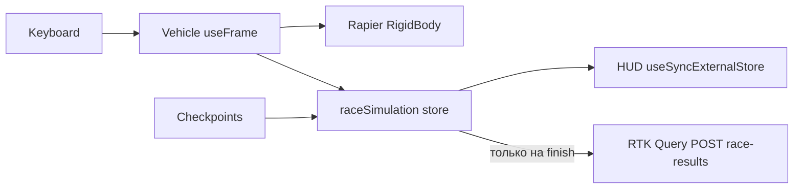

# 3D WEB Racing Platform

Браузерная **time-trial** 3D-гонка (заезд на время). Пет-проект для портфолио Senior Frontend: акцент на архитектуре фронта, 3D/физике и стабильных ~60fps, а не на зоопарке технологий.

**English:** A local browser time-trial racer (Vite SPA + NestJS). See stack and run instructions below.

## Для кого

Разработчик, который хочет показать в резюме: Feature-Sliced Design, RTK Query, R3F + Rapier, доступный UI, i18n, темизацию и честный backend к игре.

## Скриншоты и геймплей

Положите файлы в `[docs/screenshots/](docs/screenshots/)`:

- `home.png` — лендинг
- `race.png` — 3D-заезд + HUD
- `leaderboard.png` — таблица лидеров

**Как записать GIF на macOS:** QuickTime → New Screen Recording, затем конвертация:

```bash
ffmpeg -i recording.mov -vf "fps=15,scale=960:-1" docs/screenshots/gameplay.gif
```

В dev в левом верхнем углу канваса — **Stats.js** (FPS). На проверке MVP оверлей держал **60 FPS** на заезде Coastal Oval (dev preview, без постэффектов).

## Стек и почему так

| Выбор                                  | Зачем                                                                             |
| -------------------------------------- | --------------------------------------------------------------------------------- |
| **Vite + React 19**, не Next.js        | Это SPA-игра. SSR/hydration с canvas и Rapier WASM только мешают.                 |
| **pnpm workspaces**, не Turborepo      | Два приложения. Оркестратор не нужен.                                             |
| **SQLite + Prisma 7**                  | Один файл БД, без Docker. Prisma 7 + SQLite driver adapter (`better-sqlite3`).    |
| **Rapier (**`@react-three/rapier`**)** | WASM-физика в том же дереве, что R3F. Arcade, не симулятор F1.                    |
| **FSD**                                | Границы модулей читаются на собеседовании.                                        |
| **Redux Toolkit + RTK Query**          | Auth/API. Симуляция гонки **не** в Redux: vanilla-store + `useSyncExternalStore`. |
| **JWT access + httpOnly refresh**      | Access JWT 15m в памяти; refresh — opaque httpOnly cookie + ротация/revoke в БД.  |

Пакеты: `@racing/web`, `@racing/api`, `@racing/shared`. Node **22.12+**, pnpm **10**.

## Архитектура







## Как запустить локально

Требования: **Node.js 22.12+**, **pnpm 10.15**.

```bash
nvm use          # читает .nvmrc → 22.12.0; без этого Prisma 7 падает на Node 22.10
corepack disable && npm install -g pnpm@10.15.0   # если pnpm падает с Cannot find matching keyid
pnpm install
cp apps/api/.env.example apps/api/.env
cp apps/web/.env.example apps/web/.env
pnpm --filter @racing/shared build
pnpm --filter @racing/api exec prisma generate
pnpm --filter @racing/api exec prisma migrate deploy
pnpm --filter @racing/api exec prisma db seed
pnpm ready-steady-go
```

- Web: [http://localhost:5180](http://localhost:5180)
- API: [http://localhost:3000](http://localhost:3000)
- Swagger: [http://localhost:3000/docs](http://localhost:3000/docs)
- Health: [http://localhost:3000/health](http://localhost:3000/health)

### Если `pnpm` не запускается

| Симптом                                  | Решение                                           |
| ---------------------------------------- | ------------------------------------------------- |
| `Требуется Node.js 22.12+`               | `nvm use`                                         |
| `Cannot find matching keyid` (corepack)  | `corepack disable && npm install -g pnpm@10.15.0` |
| Временный обход без глобальной установки | `npx pnpm@10.15.0 dev`                            |

### Тестовые аккаунты (seed)

| Ник           | Пароль |
| ------------- | ------ |
| `test_user`   | `1234` |
| `rival_racer` | `1234` |

Трассы: **Coastal Oval** (день, овал), **Night City** (ночь, стадион).

**Музыка:** в игре звучит оригинальный chip-rock чиптюн на Web Audio (в духе Rock n' Roll Racing / SEGA Genesis). BGM стартует с входа в заезд (включая countdown), на паузе останавливается, после финиша сменяется victory-темой. Это **не** саундтрек Rock n' Roll Racing — лицензионный OST в репозиторий не включён.

## Управление в игре

- **W / ↑** — газ
- **S / ↓** — тормоз и назад
- **A / D** или **← / →** — руль
- **R** — рестарт (краткий toast «Заезд перезапущен»)
- **C** — режим камеры (chase / bumper / TV)
- **Esc** — пауза

Во время заезда слева снизу — панель управления. На канвасе — увеличенный оверлей **Stats.js** (FPS). Coastal Oval: дневное солнце; Night City: луна, звёзды и фары машины.

Чекпоинты нужно проехать **по порядку** (полупрозрачные зоны). Последняя — финиш.

## Производительность (~60fps)

- Фиксированный шаг физики `1/60`.
- HUD не подписан на Redux каждый кадр: троттлинг ~80мс, `useSyncExternalStore`.
- Геометрия окружения из примитивов; у каждого кузова гаража свой GLB (хэтчбек CarConcept, седан и пикап — отдельные меши) с preload.
- `dpr` ограничен `[1, 1.5]`, тени 1024.
- В DEV: оверлей Stats.js на канвасе.

## Тесты

```bash
pnpm test            # API Vitest (unit + e2e) + web Vitest/RTL/MSW
pnpm test:watch      # watch для api и web
pnpm test:api        # только @racing/api
pnpm test:web        # только @racing/web
pnpm test:e2e        # Playwright (алиас: pnpm e2e)
pnpm test:all        # unit/api e2e + Playwright

# точечно в пакетах
pnpm --filter @racing/api test:unit
pnpm --filter @racing/api test:e2e
pnpm --filter @racing/web e2e:ui
```

Playwright не водит машину 3 минуты: на странице заезда есть `window.__finishRaceForTest()`.

Браузеры Playwright один раз:

```bash
pnpm --filter @racing/web e2e:install
```

## Правила кода

- JSDoc `/** */` на русском у функций; `//` над эффектами — зачем подписка.
- Стрелочные функции. `function declaration` не используем.
- Типы через `type`, без `any`/`unknown`.
- Импорты только через алиасы (`@/…`, `@racing/shared`) и **public API** слайса (`index.ts`).
- Nest: классы для модулей/контроллеров/DTO (так устроены DI и `class-validator`). Методы с HTTP-декораторами — на прототипе: декоратор не вешается на стрелочное поле.

## Roadmap (не в v1)

- Геймпад
- Более богатая физика (отдельные колёса, разный грип)
- Третья трасса / GLTF-окружение
- Мобильный UX

## Известные ограничения

- Физика arcade: yaw-only, скольжение вдоль стен без отскока, макс. ~108 км/ч (30 м/с).
- Лучшее время гостя — `localStorage`; в лидерборд попадает только авторизованный финиш.
- Access JWT в памяти (сбрасывается при reload — поднимается через refresh-cookie).
- Минимальное время результата на сервере — 8 секунд (анти-чит).
- Helmet + rate limit на auth-эндпоинтах; пароль от 4 символов (демо seed `1234`).
- В prod включите `COOKIE_SECURE=true` (и при необходимости `COOKIE_SAME_SITE=none` для cross-site).
