# 3D WEB Racing Platform

[🇬🇧 English](README.md) | 🇷🇺 **Русский**

Браузерная 3D-гонка в формате **time-trial**: каждый заезд — одиночная поездка против таймера, а результат попадает в лидерборд трассы. React 19 + React Three Fiber + физика Rapier (WASM) на фронте, NestJS 11 + Prisma 7 на бэкенде. Монорепозиторий на pnpm, Feature-Sliced Design, стабильные **~60 fps** в браузере.

[](https://github.com/ramach05/3D-WEB-Racing-Platform/actions/workflows/ci.yml)
[](LICENSE)
[](.nvmrc)
[](package.json)
[](tsconfig.base.json)
[](#производительность-и-perf-hud)
[](#тесты)

**Содержание**: [Геймплей](#геймплей) · [Скриншоты](#скриншоты) · [Акценты](#инженерные-акценты) · [Фичи](#фичи) · [Управление](#управление) · [Архитектура](#архитектура) · [Стек](#стек-и-почему-именно-так) · [Auth и безопасность](#auth-и-безопасность) · [Производительность](#производительность-и-perf-hud) · [Тесты](#тесты) · [Быстрый старт](#быстрый-старт) · [Разработка](#разработка) · [Компромиссы](#компромиссы-и-ограничения) · [Roadmap](#roadmap) · [Автор](#автор)

## Геймплей

Шесть видеозаписей: обзор приложения на десктопе, заезды по всем трём трассам, а также меню и тач-управление на реальном телефоне. Клик по кадру открывает запись.

[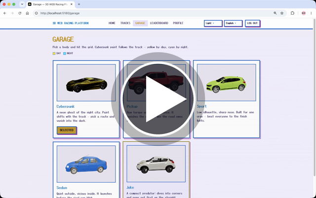](https://github.com/user-attachments/assets/2d415ffd-749e-4cc5-af74-33c140c13d3a)

| **Coastal Oval — заезд**                                                                                                                                                                                     | **Night City — заезд**                                                                                                                                    | **Storm Eight — заезд**                                                                                                                                    |
| ------------------------------------------------------------------------------------------------------------------------------------------------------------------------------------------------------------ | --------------------------------------------------------------------------------------------------------------------------------------------------------- | ---------------------------------------------------------------------------------------------------------------------------------------------------------- |
| [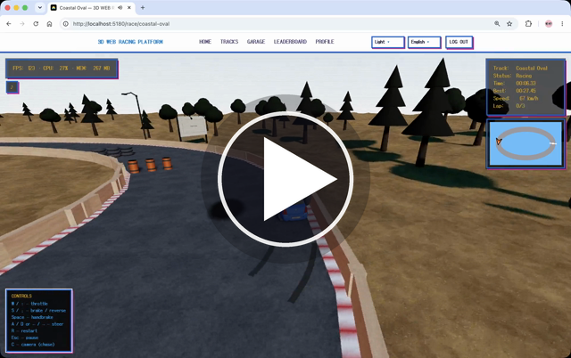](https://github.com/user-attachments/assets/c498ecdd-30b5-44a9-b9c0-831a17f0abd7) | [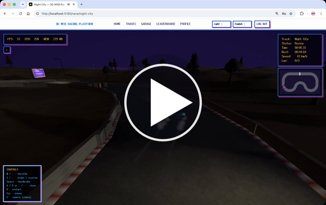](https://github.com/user-attachments/assets/9c5c004c-9ea9-42fe-ab98-77eb79ba5eec) | [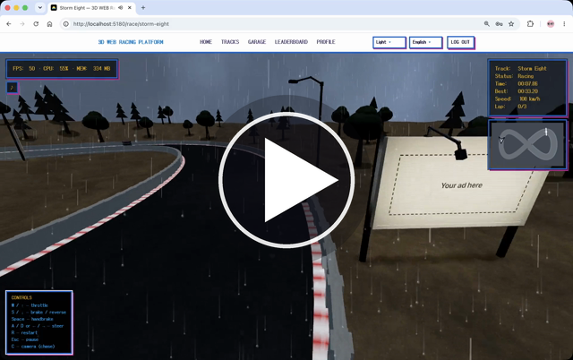](https://github.com/user-attachments/assets/20de4b3d-45f6-46e0-a3dc-69d301d81a75) |

| **Меню — телефон**                                                                                                                                                                          | **Заезд — телефон, тач-управление**                                                                                                                                                                             |
| ------------------------------------------------------------------------------------------------------------------------------------------------------------------------------------------- | --------------------------------------------------------------------------------------------------------------------------------------------------------------------------------------------------------------- |
| <a href="https://github.com/user-attachments/assets/a147ac49-a1af-473c-8050-914c22742344">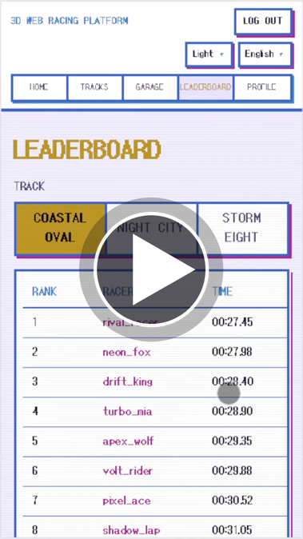</a> | <a href="https://github.com/user-attachments/assets/a7a69c8b-74ad-4631-a6b6-faa01e2892c7">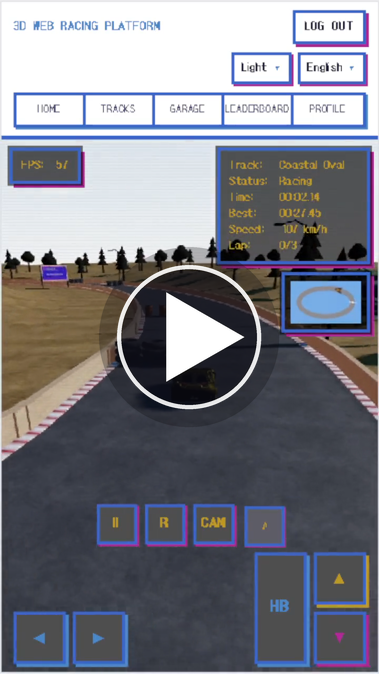</a> |

## Скриншоты

Десктопные экраны (клик открывает полный размер):

| **Главная**                                                               | **Трассы**                                                                      | **Гараж**                                                                   | **Лидерборд**                                                                             |
| ------------------------------------------------------------------------- | ------------------------------------------------------------------------------- | --------------------------------------------------------------------------- | ----------------------------------------------------------------------------------------- |
| [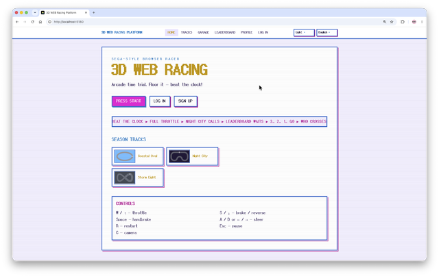](docs/screenshots/home.png) | [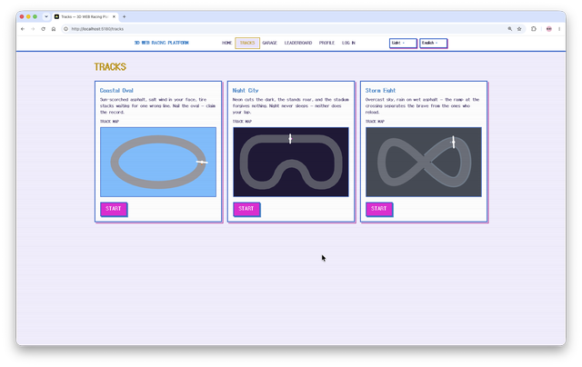](docs/screenshots/tracks.png)    | [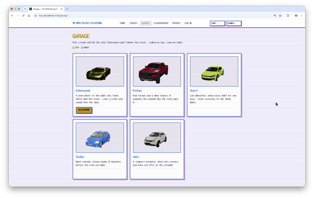](docs/screenshots/garage.png) | [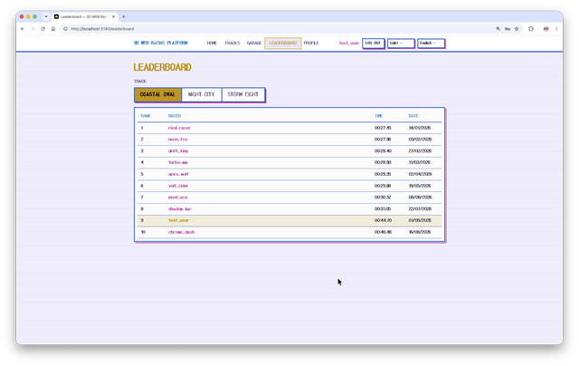](docs/screenshots/leaderboard.png) |
| **Логин**                                                                 | **Профиль**                                                                     | **Финиш** — SEGA-момент                                                     |                                                                                           |
| [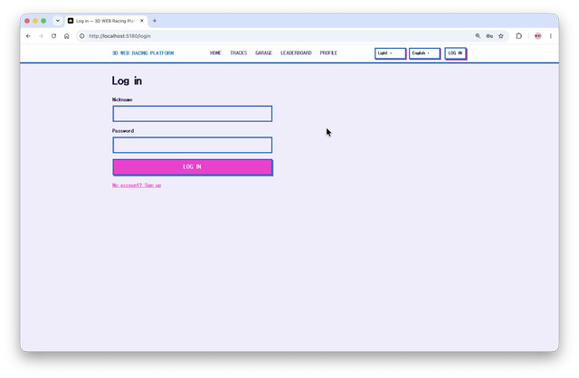](docs/screenshots/login.png) | [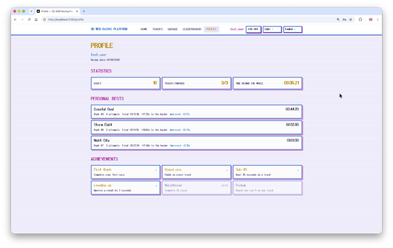](docs/screenshots/profile.png) | [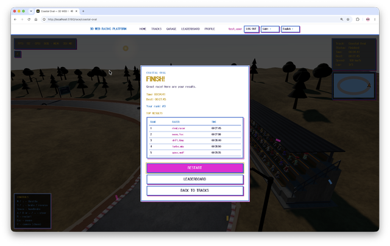](docs/screenshots/finish.png) |                                                                                           |

Светлая и тёмная темы, переключение в один клик:

| **Светлая**                                                                    | **Тёмная**                                                                              |
| ------------------------------------------------------------------------------ | --------------------------------------------------------------------------------------- |
| [](docs/screenshots/home.png) | [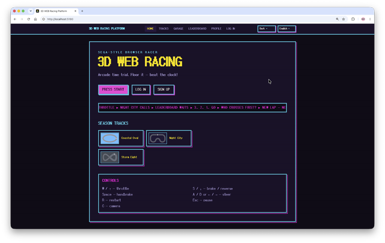](docs/screenshots/home-dark.png) |

Трассы:

| **Coastal Oval** — полные трибуны, тени от солнца                                  | **Night City** — луна, фары, фонари, неон bloom                                  | **Storm Eight** — дождь, мокрый асфальт, эстакада                                                     |
| ---------------------------------------------------------------------------------- | -------------------------------------------------------------------------------- | ----------------------------------------------------------------------------------------------------- |
| [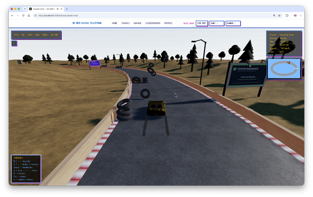](docs/screenshots/race-1.png) | [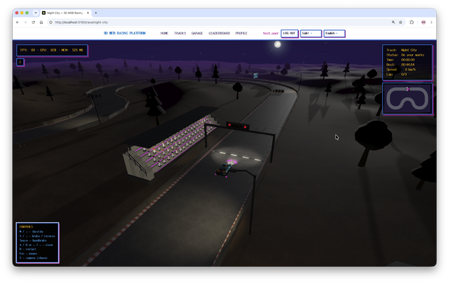](docs/screenshots/race-2.png) | [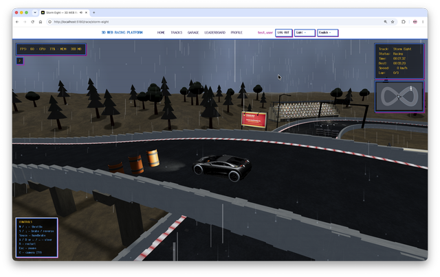](docs/screenshots/race-3-camera-tv.png) |

Камеры — chase / bumper / TV:

| **Chase**                                                                          | **Bumper**                                                                                                      | **TV**                                                                                              |
| ---------------------------------------------------------------------------------- | --------------------------------------------------------------------------------------------------------------- | --------------------------------------------------------------------------------------------------- |
| [](docs/screenshots/race-1.png) | [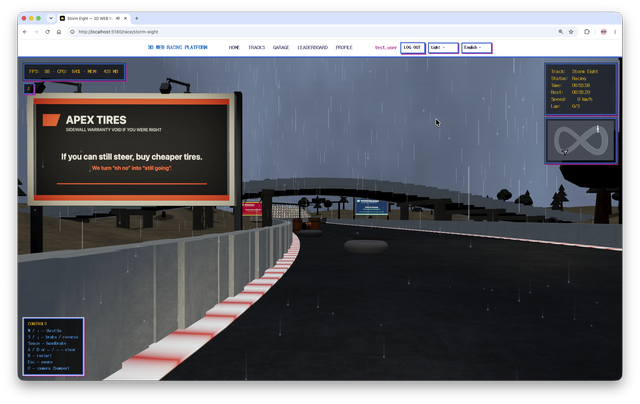](docs/screenshots/race-3-camera-bumper.png) | [](docs/screenshots/race-3-camera-tv.png) |

Мобильные экраны:

| **Главная**                                                                                                 | **Трассы**                                                                                                     | **Гараж**                                                                                                     | **Лидерборд**                                                                                                               | **Профиль**                                                                                                       |
| ----------------------------------------------------------------------------------------------------------- | -------------------------------------------------------------------------------------------------------------- | ------------------------------------------------------------------------------------------------------------- | --------------------------------------------------------------------------------------------------------------------------- | ----------------------------------------------------------------------------------------------------------------- |
| [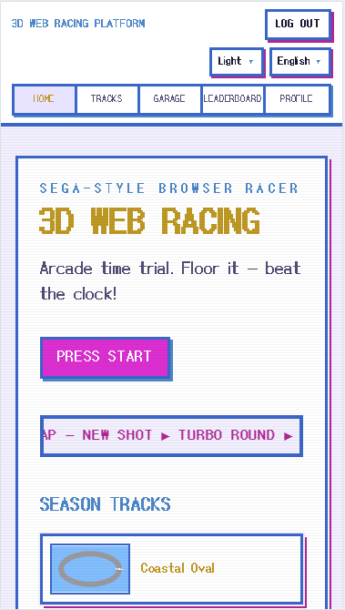](docs/screenshots/mobile/home-mobile.png) | [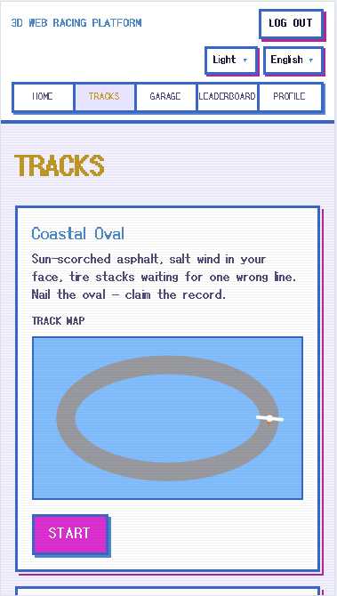](docs/screenshots/mobile/tracks-mobile.png) | [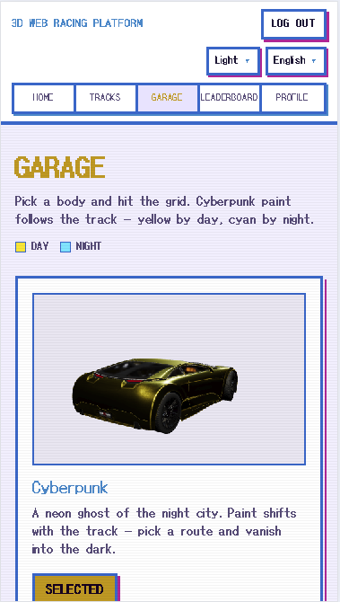](docs/screenshots/mobile/garage-mobile.png) | [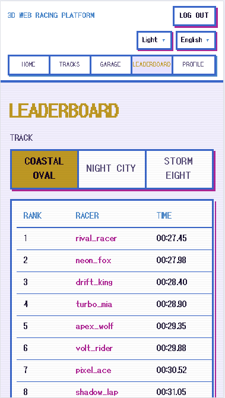](docs/screenshots/mobile/leaderboard-mobile.png) | [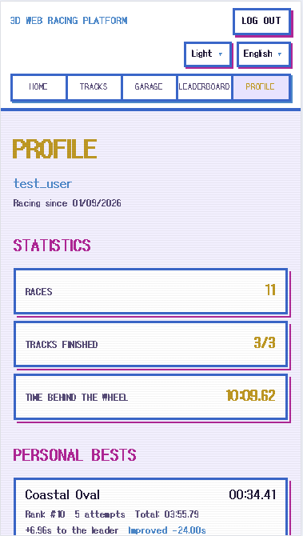](docs/screenshots/mobile/profile-mobile.png) |

## Инженерные акценты

- **Симуляция заезда — не в Redux.** Покадровое состояние живёт в маленьком vanilla-store; HUD читает его через `useSyncExternalStore` с троттлингом ~80 мс, а таймер и скорость пишутся прямо в DOM. Причина: React-ререндеры на каждый кадр физики заметно просаживали FPS в Chrome. Redux/RTK Query — только auth/API и один POST на финише. → [Производительность](#производительность-и-perf-hud)
- **Полный жизненный цикл токенов, а не «эндпоинт логина».** Короткий 15-минутный access JWT живёт только в памяти. Refresh-токен — в httpOnly-куке с ограничением по path, в базе хранится только его SHA-256-хеш. Каждое обновление заменяет токен; повторное использование уже заменённого — типичный признак кражи: отзываются **все** сессии пользователя. → [Auth и безопасность](#auth-и-безопасность)
- **572 unit/интеграционных теста + 5 пользовательских Playwright-флоу.** CI прогоняет `lint → typecheck → migrate → test → build` на каждом пуше; pre-commit-хук повторяет lint/prettier/typecheck локально. → [Тесты](#тесты)
- **Границы FSD исполняются, а не документируются.** ESLint запрещает глубокие импорты слайсов, `any`/`unknown`, относительные импорты через родителя и default-экспорты.
- **Внутриигровой perf-HUD** — FPS, загрузка main-thread %, JS heap — всё, что браузер честно может измерить о себе. → [Производительность](#производительность-и-perf-hud)
- **Запатченный upstream поставляется вместе с репозиторием** через pnpm `patchedDependencies`: GLTF-загрузчик three-stdlib декодирует текстуры сразу в `ImageBitmap` вместо blob-URL — preload быстрее, утечек нет.

## Фичи

**Три трассы — у каждой своя погода, палитра и музыка**

| Трасса       | Сеттинг    | Характер                                                                                                    |
| ------------ | ---------- | ----------------------------------------------------------------------------------------------------------- |
| Coastal Oval | Ясный день | Быстрый овал, тени от солнца, полные трибуны                                                                |
| Night City   | Ночь, ясно | Луна + фары + фонари с LOD, неон через bloom/vignette                                                       |
| Storm Eight  | Дождь      | «Восьмёрка» с эстакадой над пересечением, мокрый асфальт, дождь и брызги из-под колёс, штормовое небо и BGM |

На каждой: несколько кругов с чекпоинтами по порядку, динамические препятствия (штабели покрышек, топливные бочки, от которых отскакиваешь), масляные лужи, режущие сцепление, и весь трексайд с настоящими коллайдерами (деревья, билборды, фонари, трибуны).

**Гараж — 5 GLB-кузовов в реальном масштабе классов** (4,14–5,71 м): хэтчбек, седан, пикап, Juke, спорт-кузов. Окрас меняется под выбранную трассу; превью в гараже живое — колеса поворачиваются за рулём и вращаются от измеренных осей.

**Физика (Rapier WASM)** — arcade, но согласованная: фиксированный шаг 1/60, руление независимо от частоты кадров, занос ручником, ощущение покрытий (асфальт / кербы / обочина), демпфирование динамических препятствий, машина прижата к покрытию на убывающих пролётах эстакады и гребнях подъёмов.

**Графика** — процедурные canvas-текстуры (асфальт, кербы, кора, болельщицкие шапки и флаги), тени солнца/луны, следующие за машиной, скид-метки на весь заезд, дым от шин, режимы стоп-сигналов и задних огней, пучки фар, привязанные к _визуальной_ позе машины (без задержки), стартовая арка в стиле F1.

**Звук — на 100 % синтезирован на JavaScript.** Chip-rock BGM генерируется через Web Audio API (осцилляторы + фильтрованный шум, своя тема у каждой трассы, ~150 BPM, штормовые вариации, victory-тема на финише), плюс driving-SFX и звук дождя. Ни одного аудиофайла в репозитории.

**UX заезда** — три камеры (chase / bumper / TV) с FOV и тряской, живая миникарта с маркером — проекцией позы машины на карту, SEGA-момент финиша, пауза, рестарт.

**Вокруг заезда** — лидерборды по трассам (на сервере, фильтр по slug), гостевой режим с рекордами в `localStorage`, профиль со сводной статистикой, лучшими временами по трассам с местом и отставанием от лидера и 6 достижениями; i18n (EN/RU); светлая/тёмная тема; **мобильная поддержка**: тач-контроли (газ / тормоз / руль / ручник), компактный HUD, safe-area и адаптивная верстка до ширины телефона. Меню и модальные окна управляются с клавиатуры, focus trap на месте.

## Управление

| Действие                 | Клавиатура      | Тач                  |
| ------------------------ | --------------- | -------------------- |
| Газ / тормоз+назад       | W / ↑ · S / ↓   | экранные педали      |
| Руль                     | A / D или ← / → | экранные кнопки руля |
| Ручник (drift)           | Space           | кнопка ручника       |
| Камера (chase/bumper/TV) | C               | —                    |
| Рестарт / пауза          | R / Esc         | кнопки HUD           |

## Архитектура

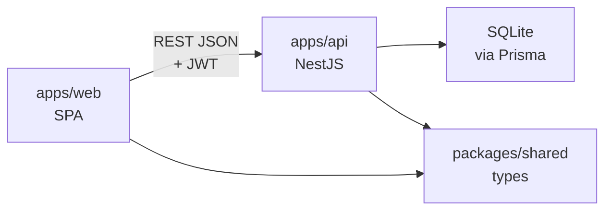

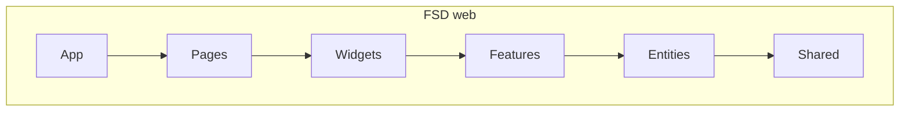

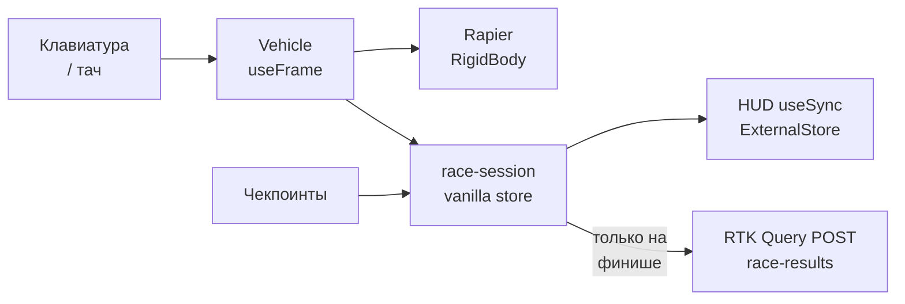

```
apps/
  web/                 # Vite + React 19 SPA (игра)
    src/
      app/             # вход, роутер, Redux store, i18n, CSS-переменные тем
      pages/           # home, race, garage, tracks, leaderboard, profile, login, register
      widgets/         # race-canvas, hud, миникарта, countdown, пауза, финиш, лидерборд, превью авто
      features/        # auth, race-session (store/input/физика), race-audio, race-perf,
                       # backend-status, переключатели локали/темы, выбор кузова
      entities/        # track (раскладка, погода, препятствия), vehicle (GLB-каталог),
                       # leaderboard, race-result (достижения)
      shared/          # api base, config (палитра, i18n-сообщения), ui-kit, lib
    e2e/               # Playwright-флоу
  api/                 # NestJS 11: auth, tracks, race-results, health; Prisma 7 + SQLite
packages/
  shared/              # транспортные типы и константы — единый источник для обоих приложений
```

## Стек и почему именно так

| Выбор                                                 | Зачем                                                                                                                                                        |
| ----------------------------------------------------- | ------------------------------------------------------------------------------------------------------------------------------------------------------------ |
| **Vite + React 19**, не Next.js                       | Это SPA-игра. SSR/hydration с WebGL-канвасом и Rapier WASM только мешали бы.                                                                                 |
| **Симуляция вне Redux**                               | Покадровое состояние в глобальном сторе = покадровые ререндеры. Vanilla-store + `useSyncExternalStore` держат HUD вне 3D-кадра.                              |
| **Rapier (`@react-three/rapier`)**                    | Детерминированная WASM-физика в том же дереве, что R3F; фиксированный шаг 1/60. Задача — arcade, а не симулятор F1.                                          |
| **three.js-примитивы + процедурные текстуры**         | Бюджет ~60 fps отсекает маркетплейсное GLTF-окружение. GLB — только 5 кузовов гаража, остальное — геометрия и canvas-текстуры: лёгкий вес и полный контроль. |
| **@react-three/drei**                                 | Готовые хелперы сцены — `Sky`/`Stars`, `Billboard`, `useGLTF` — не нужно писать скайбокс, биллбординг и загрузку GLTF руками.                                |
| **@react-three/postprocessing**                       | Конвейер постэффектов (`Bloom` + `Vignette`) для неонового свечения Night City; включаем его только там, где позволяет бюджет 60 fps.                        |
| **Tailwind CSS 4**                                    | Utility-стили для всей 2D-обвязки (HUD, меню, карточки) через Vite-плагин; сама 3D-сцена оформляется кодом, а не CSS.                                        |
| **i18next + react-i18next**                           | Локализация EN/RU из одного дерева `messages.ts`; переключение в рантайме, словари общие для UI и тестов.                                                    |
| **Redux Toolkit + RTK Query**                         | Там, где им место: auth-состояние, кеш API, точечные мутации.                                                                                                |
| **NestJS 11**                                         | Структурированные DI, гарды, конвейеры валидации и декораторы; DTO с `class-validator` дают реальные границы входа.                                          |
| **helmet + @nestjs/throttler**                        | Заголовки безопасности и rate-limit на auth-роутах — дешёвый харденинг, закрывающий очевидную поверхность атаки.                                             |
| **SQLite + Prisma 7** (driver adapter better-sqlite3) | Один файл БД, никакого Docker — клонировал и запустил; Prisma-типы общие с фронтом через `@racing/shared`.                                                   |
| **JWT access + ротируемый httpOnly refresh**          | См. [Auth и безопасность](#auth-и-безопасность).                                                                                                             |
| **Web Audio-синтез**, а не аудиофайлы                 | Музыка и SFX — это код: никаких бинарных ассетов и лицензий, темы собираются из примитивов нот, а сам синтезатор — отдельная демонстрация API.               |
| **pnpm workspaces**, не Turborepo                     | Два приложения и один общий пакет — оркестратор был бы лишним ритуалом. Патч upstream живёт в репо через `patchedDependencies`.                              |

Пакеты: `@racing/web`, `@racing/api`, `@racing/shared`. Node **22.12+**, pnpm **10.15**.

## Auth и безопасность

**Модель токенов**

1. Логин/регистрация возвращают **15-минутный access JWT** (HS256, фиксированные issuer/audience), который клиент держит **только в памяти** — не в `localStorage`, так что XSS не может украсть персистентный токен; после перезагрузки страницы сессия прозрачно восстанавливается refresh-кукой.
2. **Refresh — opaque случайная строка в httpOnly-куке с `path=/auth`** (`Secure`/`SameSite` настраиваются под прод). В базе хранится только его **SHA-256-хеш** — утечка БД не даёт ничего применимого.
3. Каждый `/auth/refresh` **заменяет** токен: старая сессия отзывается, в базе фиксируется, какой токен заменил предыдущий (`replacedById`). Повторное использование уже заменённого токена — типичный признак кражи: **отзываются все сессии пользователя**. Просроченные сессии вычищаются.

**Защита**

- Пароли: bcrypt (cost 10); пароль при входе несуществующего пользователя сравнивается с dummy-хешем, чтобы время ответа не выдавало наличие аккаунта.
- CSRF на куковых эндпоинтах (`/auth/refresh`, `/auth/logout`): при наличии refresh-кука обязателен кастомный заголовок `X-Requested-With` — форма с другого домена не сможет его отправить.
- Helmet, rate limit `@nestjs/throttler` на auth-маршрутах, глобальный `ValidationPipe` с `whitelist` + `forbidNonWhitelisted`.
- Fail-fast на старте при неверном окружении (плейсхолдер `JWT_SECRET`, отсутствие `COOKIE_SECURE`/`CORS_ORIGIN` в проде); Swagger в проде отключён.
- Серверный анти-чит: результаты быстрее 8 с (физически невозможно) отклоняются; порядок чекпоинтов валидируется на клиенте.

Честно о границах: это уровень портфолио-проекта, а не платежной системы — симметричный HS256, без фингерпринта устройства и серверной симуляции круга. Модель выбрана, чтобы показать корректную токен-гигиену на масштабе демо.

## Производительность и perf-HUD

Бюджет — **~60 fps**. Никаких трюков — только базовые приёмы, каждый с измеримой причиной:

- Физика с фиксированным шагом 1/60; управление и хендлинг зависят от `dt`, а не от числа кадров.
- Уведомления HUD троттлятся ~80 мс; время/скорость пишутся в DOM напрямую в rAF-цикле — React-стейт-апдейты внутри `useFrame` были причиной реального фриза в Chrome (коммит `1633782`).
- Рендер: `dpr` ограничен `[1, 1.5]`, карты теней 1024, тени солнца/луны следуют за машиной, прожекторы фонарей с LOD-отсечкой по дистанции, бюджеты света/теней на сцену (Night City), Bloom+Vignette только на ночной трассе.
- Ассеты: всё процедурное, кроме 5 GLB-кузовов; патченный GLTF-загрузчик декодирует текстуры сразу в `ImageBitmap`; кузова предзагружаются до монтирования заезда; маршруты — lazy-load.
- Размер бандла (по `pnpm build`): оболочка приложения + Redux/i18n/роутер весят **~93 kB gz** (JS 84 + CSS 9); 3D-движок — three, Rapier WASM, постэффекты, 1.29 MB gz — отдельный чанк, который грузится только при открытии заезда или превью в гараже.
- Уровень приложения: SPA гейтится по готовности API, идемпотентные GET ретраятся с backoff, WebGL-контекст восстанавливается после потери.

**Perf-HUD (FPS / CPU / MEM).** Браузер не может прочитать системный CPU, поэтому HUD меряет то, что честно доступно: **FPS** — число отрисованных кадров/с; **CPU%** — доля времени main-thread, уходящая на работу по фрейму (замер в цикле рендера, сэмпл каждые 250 мс), то есть «насколько эта вкладка загружает машину»; **MEM** — `performance.memory.usedJSHeapSize` (куча JS), API доступен только в Chromium, в остальных скрывается. Статистика заезда (круг, сплит, лучшее) идёт рядом со стоимостью её отрисовки.

Замерено: 60 fps при проверке MVP на заездах Coastal Oval (dev preview, оверлей Stats.js). Проверьте сами — HUD прямо в игре.

## Тесты

```
572 теста (Vitest) — 536 web (unit + RTL/MSW-интеграция, 101 файл) · 28 API unit · 8 API e2e (supertest на настоящем Nest-приложении, временная SQLite)
5 Playwright-флоу — auth/logout, гостевой профиль, флоу заезда, тема+локаль, трассы+лидерборд
```

- Интеграционные тесты на MSW вместо ручных моков RTK Query; необработанные запросы валят тест.
- Playwright не ездит на машине по три минуты: на странице заезда есть `window.__finishRaceForTest()`, и флоу финишит через реальный API-путь.
- Любая смена логики — тест в том же коммите: физика, чекпоинты, правила кругов, раскладка препятствий, ротация токенов, анти-чит-планка.

## Быстрый старт

```bash
pnpm install
cp apps/api/.env.example apps/api/.env && cp apps/web/.env.example apps/web/.env
pnpm --filter @racing/api prisma:generate   # генерируемый клиент не лежит в git
pnpm ready-steady-go                        # сборка shared → prisma migrate+seed → web + api
```

| Игра                                           | API                                            | Документация API                    | Health                                  |
| ---------------------------------------------- | ---------------------------------------------- | ----------------------------------- | --------------------------------------- |
| [http://localhost:5180](http://localhost:5180) | [http://localhost:3000](http://localhost:3000) | [/docs](http://localhost:3000/docs) | [/health](http://localhost:3000/health) |

Seed-аккаунты: `test_user` / `1234` (и соперник `rival_racer` / `1234`). Нужны Node **22.12+** и pnpm **10.15**. Если что-то не стартует — таблица траблшутинга и полная матрица команд в [docs/development.ru.md](docs/development.ru.md).

## Разработка

| Команда                                            | Что делает                                           |
| -------------------------------------------------- | ---------------------------------------------------- |
| `pnpm ready-steady-go`                             | полный dev-цикл из [Быстрого старта](#быстрый-старт) |
| `pnpm lint` / `pnpm typecheck` / `pnpm format`     | ESLint (`--max-warnings=0`), `tsc -b`, Prettier      |
| `pnpm test` / `test:web` / `test:api` / `test:e2e` | Vitest (unit + RTL/MSW), API e2e, Playwright         |
| `pnpm build`                                       | прод-сборка всех пакетов                             |

husky pre-commit-хук локально прогоняет lint/format/typecheck; коммиты — по Conventional Commits (`feat(web): …`). CI (GitHub Actions, Node 22.12) на каждом пуше держит те же гейты: `lint → typecheck → migrate → test → build`. Полная матрица команд, траблшутинг и правила кода — в [docs/development.ru.md](docs/development.ru.md).

## Компромиссы и ограничения

- **Arcade-физика**: yaw-only, от стен машина скользит вдоль, а не отскакивает, макс. ~108 км/ч. Симулятор с детализированными шинами — это другой проект.
- **Анти-чит минимальный**: серверная планка 8 с + порядок чекпоинтов на клиенте. Серверно-авторитарная симуляция круга — следующий шаг.
- Рекорды гостя живут в `localStorage`; в лидерборд попадают только авторизованные финиши.
- Access JWT умирает при перезагрузке — это по дизайну (восстанавливается refresh-кукой).
- `performance.memory` — только Chromium: в Firefox/Safari MEM скрывается.
- SQLite без пула соединений: допустимо для демо, неприемлемо под нагрузкой; Prisma делает переезд дёшёвым.

## Roadmap

- Геймпад
- Колесная физика (независимая подвеска, грип по покрышкам)
- Новые трассы / маркетплейс-GLTF-окружение
- Ghost-replays из записанной телеметрии
- Хостинг демо (web на статик-хостинг, API на маленький VPS/Fly)

## Лицензия

[MIT](LICENSE)

## Автор

**Roman Kovalenko** — соло-автор: концепция продукта, архитектура, фронтенд (React / R3F / Rapier / Web Audio), бэкенд (NestJS / Prisma), тесты и CI.

[github.com/ramach05](https://github.com/ramach05) · [linkedin.com/in/ramach05](https://linkedin.com/in/ramach05)
